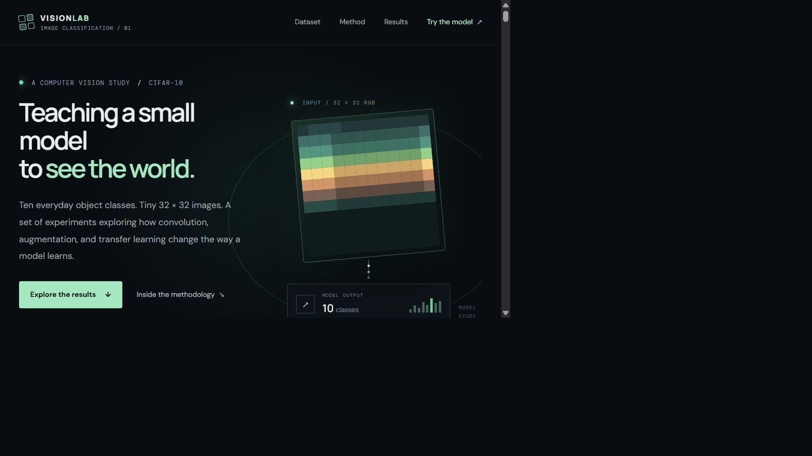
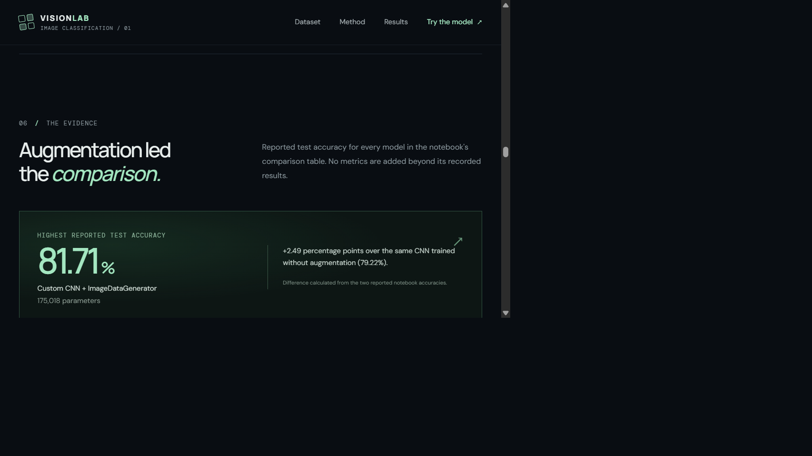
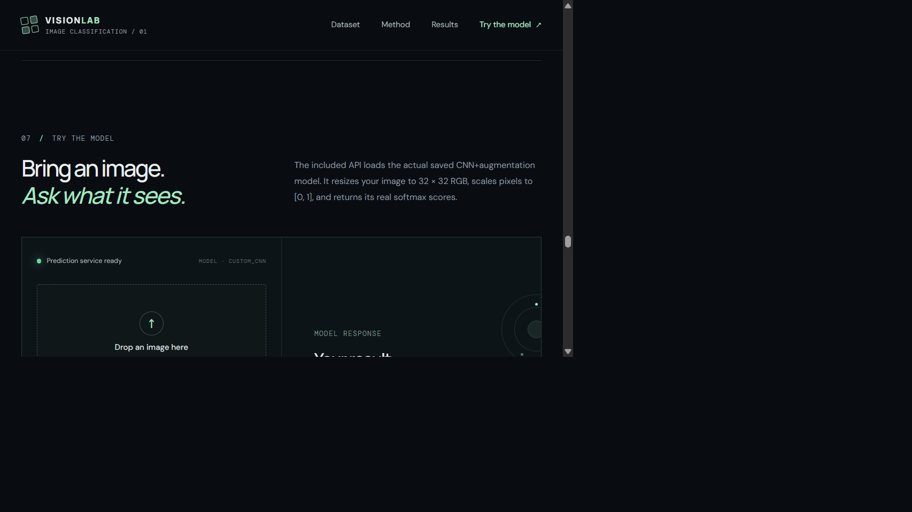

# CIFAR-10 Vision Lab

**An interactive image-classification project showcase by [Neel Patel](https://github.com/patelneel9080).**

This repository turns the experiments in the original Jupyter Notebook into a responsive website. Visitors can explore the dataset, preprocessing, model architectures, training, evaluation, notebook figures, and a live image-classification demo without opening the notebook.

**Repository:** [github.com/patelneel9080/Image-Classification](https://github.com/patelneel9080/Image-Classification)

> Copyright © 2026 Neel Patel. All rights reserved. No permission is granted to reuse or redistribute this project's original code, text, model, or visual assets. CIFAR-10 and third-party libraries remain subject to their respective terms.

## View the showcase

- **Run locally:** follow the quick start below, then open [http://127.0.0.1:8000](http://127.0.0.1:8000).
- **GitHub Pages:** after enabling Pages with GitHub Actions, the expected address is [https://patelneel9080.github.io/Image-Classification/](https://patelneel9080.github.io/Image-Classification/).

GitHub Pages hosts the static showcase only. The live prediction API needs a separate Python service; see [Deploy](#deploy).

## Website screenshots

**Project overview**



**Notebook-backed results**



**Live image-classification demo**



## Quick start on Windows

### Requirements

- Git
- Python 3.11
- Internet access for the initial Python package installation

Clone the repository and create an isolated environment:

```powershell
git clone https://github.com/patelneel9080/Image-Classification.git
cd Image-Classification
py -3.11 -m venv .venv
.\.venv\Scripts\python.exe -m pip install --upgrade pip
.\.venv\Scripts\python.exe -m pip install -r backend\requirements.txt
```

Start the website and prediction API:

```powershell
.\.venv\Scripts\python.exe -m uvicorn backend.app:app --reload
```

Keep that terminal open while using the site. Visit **http://127.0.0.1:8000** in your browser. To stop the server, press `Ctrl+C` in the terminal.

Check that the trained model loaded by opening **http://127.0.0.1:8000/api/health**. A working response looks like:

```json
{
  "model_loaded": true,
  "model": "Custom_CNN · CIFAR-10"
}
```

If PowerShell cannot find `py -3.11`, install Python 3.11 and enable the Python launcher, or use the full path to your Python 3.11 executable to create `.venv`.

### Try live classification

1. Open the local site while the Uvicorn process is running.
2. Scroll to **Try the model**.
3. Upload a PNG, JPEG, WEBP, or GIF image (maximum 8 MB).
4. Select **Run classification** to see the model's real top prediction and softmax scores.

The API uses the included `backend/best_cifar10_model.keras` model. It converts the uploaded image to RGB, resizes it to 32 × 32, and scales pixel values to `[0, 1]`, matching the notebook's input preprocessing. The model predicts one of the ten CIFAR-10 classes. Softmax scores are model outputs, not calibrated probabilities; predictions on images unlike CIFAR-10 may be unreliable.

If the page says **Prediction service offline**, make sure the Uvicorn terminal is still running and that you opened the site at `http://127.0.0.1:8000`. Opening `site/index.html` directly or serving it from a static-only server will not start the Python API.

## What the website contains

- Project overview, problem context, libraries, and objectives
- CIFAR-10 dataset size, class distribution, image dimensions, and data split
- Preprocessing, normalization, label encoding, augmentation, and visual examples
- Custom CNN, LeNet-5, MobileNetV2, and residual-block architecture information
- Training configuration and notebook training/validation curves
- The six-model accuracy comparison, classification report, and confusion matrix
- Notebook examples of actual misclassified images with ground-truth and predicted labels
- All **12 embedded notebook figures** and an expandable archive of **58 saved outputs from 28 notebook cells**, including training logs and layer summaries
- An upload-and-predict interface connected to the saved model

All reported values and visual outputs are taken from the executed notebook. The notebook's classification report and confusion matrix are for the unaugmented scratch CNN (79.22%); they are not presented as metrics for the augmented model.

### Evaluation caveat

The notebook reports 81.71% test accuracy for its CNN trained with `ImageDataGenerator`. In that run, the test set is also used as validation data and later evaluated again, so 81.71% is not an untouched holdout estimate. The notebook's later comparison table reports MobileNetV2 feature extraction as 0.8100; an earlier standalone evaluation prints 0.7995 because the comparison reuses the model after fine-tuning. Both notebook results are preserved and explained on the site.

## Deploy

### Static showcase with GitHub Pages

1. Push this repository to GitHub.
2. Open **Settings → Pages** for the repository.
3. Set the build and deployment source to **GitHub Actions**.
4. The included `.github/workflows/pages.yml` publishes the `site/` directory when changes are pushed to `main` or the workflow is run manually.

The expected Pages URL is `https://patelneel9080.github.io/Image-Classification/` once the first deployment succeeds. GitHub Pages cannot run TensorFlow, so the prediction service will remain offline there until the API is deployed separately.

### Live prediction API

Deploy the `backend/` directory as a Python web service (for example, on Render):

- **Build command:** `pip install -r requirements.txt`
- **Start command:** `uvicorn app:app --host 0.0.0.0 --port $PORT`
- **Environment variable:** `PROJECT_CORS_ORIGINS` set to the exact website origin, e.g. `https://patelneel9080.github.io`

After deployment, set the API URL in `site/assets/js/config.js`:

```js
window.PROJECT_API_BASE = "https://your-api-service.example.com";
```

Redeploy the static site after changing the API URL. Keep the CORS origins limited to the website's real origin. For local development, the site and API share one origin, so no additional CORS configuration is needed.

## Project structure

```text
Image_Classification.ipynb              Original notebook (kept unchanged)
README.md
backend/
  app.py                                 FastAPI API and local site server
  best_cifar10_model.keras               Trained model selected by the notebook
  requirements.txt                      Python serving dependencies
site/
  index.html                             Responsive project showcase
  assets/
    css/styles.css
    js/                                  Site interactions and API configuration
    data/                                Figure manifest, output archive, model comparison
    notebook-outputs/                    Original notebook figures
.github/
  workflows/pages.yml                   GitHub Pages deployment workflow
```

The GitHub Pages workflow publishes only `site/`; the notebook remains in the repository as the original source but is not served or linked from the showcase.

## Ownership

The visible author credit and copyright notice identify the project as Neel Patel's work. They do not technically prevent copying or guarantee enforcement. The repository currently has no separate `LICENSE` file; third-party datasets, libraries, and other materials retain their own licenses and terms.
